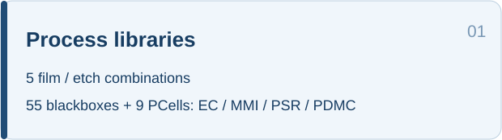
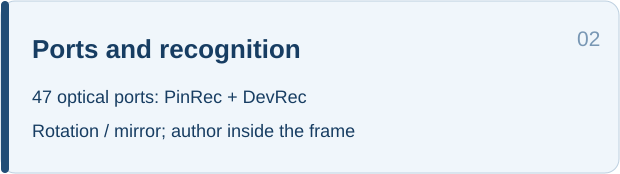
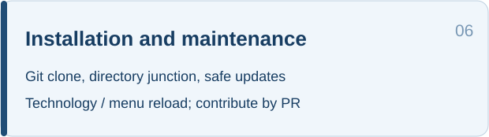

  
  

# JNU_MWP_TFLN_PDK

A KLayout thin-film lithium niobate (TFLN) PDK from the Jinan University optoelectronic hybrid integration laboratory. V1.0 provides the `JNU_MWP_TFLN_PDK` Technology, four process libraries, 12 fixed blackboxes, 47 optical ports, nine public PCells and a layout menu.

The public edition can be installed and used independently. Blackboxes retain rectangular placeholders, PinRec, DevRec, device labels and author text. Whitebox GDS, FSP projects and internal device geometry are distributed through separate authorization. Blackboxes support placement and port connections; fabrication requires authorized whitebox geometry.

## Installation and updates

### Windows: drag the installer into KLayout

First installation requires KLayout 0.30.x with Python macros and [Git](https://git-scm.com/downloads).

1. **[Download Install_JNU_TFLN_PDK.lym](https://github.com/Jerry-behappy/JNU_MWP_TFLN_PDK/releases/download/installer-macro/Install_JNU_TFLN_PDK.lym)**.
2. Drag the `.lym` into the KLayout you normally use. Select **Install JNU TFLN PDK** in **Macro Development**, click the green **Run** button, then click **安装 / 更新** (Install / Update).
3. Restart KLayout, select `JNU_MWP_TFLN_PDK`, and check the five libraries and the `JNU_MWP_TFLN_PDK V1.0` menu.

The macro reads the user directory from the running KLayout, clones main in the background and creates a directory junction. No manual path entry or shared drive with KLayout is needed. Run the same macro again to safely update an existing public Git installation. AI installation prompts are provided below.

### Install or update with an AI agent

Copy these prompts to an agent with local file and command access.

**Installation prompt**

> Install https://github.com/Jerry-behappy/JNU_MWP_TFLN_PDK in the KLayout I normally use. Prefer Install_JNU_TFLN_PDK.lym to read its user directory automatically and install using Git and a directory junction. Preserve other PDKs, existing TFLN installations, whiteboxes and local edits. Restart and verify the Technology, five libraries, 12 blackboxes and nine PCells and menu.

**Update prompt**

> Update my installed JNU_MWP_TFLN_PDK. Locate its actual Git clone and update the current branch only when the worktree is clean and a fast-forward is possible. Preserve local edits and authorized whiteboxes. Verify the libraries and menu and tell me whether KLayout needs to restart.

### Maintenance and whiteboxes

- Run the installer macro again and click **Install / Update** to check the remote and fast-forward a clean main checkout. Alternatively, run `git pull --ff-only origin main`. Restart KLayout after updating; **Reload TFLN PDK** also supports Python-only changes.
- Whiteboxes and original simulation projects are stored and authorized separately. The menu can import authorized local GDS into a separate private directory. This repository provides no whitebox downloads.
- Contributions use feature branches and pull requests. Direct pushes, force pushes and deletion of `main` are blocked.

## Process libraries

| Library | Film / etch depth (nm) | Devices | Count |
|---|---:|---|---:|
| `JNULib_TFLN_300_125` | 300 / 125 | EC01 | 1 |
| `JNULib_TFLN_400_200` | 400 / 200 | EC02 | 1 |
| `JNULib_TFLN_600_300` | 600 / 300 | EC03, MMI01–06, POL01–02 | 9 |
| `JNULib_TFLN_600_600` | 600 / 600 | EC04 | 1 |
| `JNULib_TFLN_pcell` | 参数化 / Parametric | SOI 公开 PCell / Public SOI PCells | 9 |

See the [device index](docs/DEVICE_INDEX.md) for parameters, ports and file links. Lower steps of EC01–EC03 remain pending. Unknown parameters use `Unknow`; discrepancies are retained in the public manifest.

The 26-action menu covers JNU PDK waveguide/layout tools, DRC, updates and local authorized-library import, with Chinese and English displayed together. PCells retain SOI dimensions and geometry; TFLN optical performance needs separate validation. Author text is omitted from Library descriptions and retained inside fixed GDS frames.

## Features and user guide

Click a feature card to open the [user guide](docs/USER_GUIDE.md). Menu labels show Chinese and English together. The database unit is **0.0001 µm**.

<table>
  <tr><th colspan="2">JNU_MWP_TFLN_PDK V1.0 · Features</th></tr>
  <tr>
    <td width="50%"></td>
    <td width="50%"></td>
  </tr>
  <tr>
    <td width="50%"></td>
    <td width="50%"></td>
  </tr>
  <tr>
    <td width="50%"></td>
    <td width="50%"></td>
  </tr>
</table>

Native author text inside each recognition frame: **By Songliang Chen, 2026/10/13**.

[Changelog](CHANGELOG.en.md) · [Issues](https://github.com/Jerry-behappy/JNU_MWP_TFLN_PDK/issues) · [License](LICENSE.md) · [Related SOI PDK](https://github.com/Jerry-behappy/JNU-MWP-SOI-PDK)
