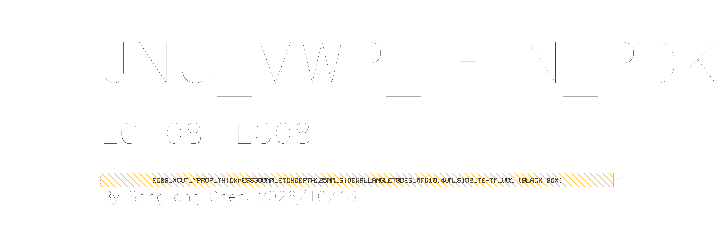
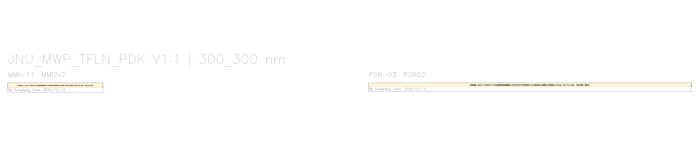
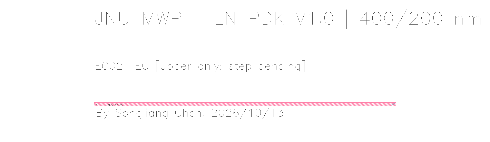
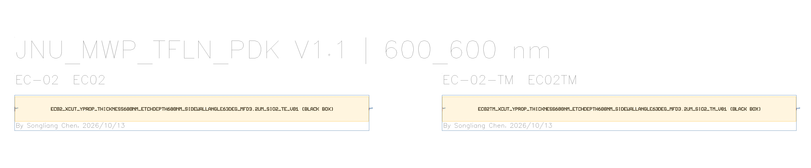

<p align="center"></p>

# JNU_MWP_TFLN_PDK V1.1

暨南大学光电混合集成实验室 KLayout 薄膜铌酸锂 PDK。本分支按最新清单登记 55 个固定黑盒、216 个光学端口、五组膜厚/刻蚀 Library，以及九个独立 PCell。

[English](README.en.md) · [器件参数与文件索引](docs/DEVICE_INDEX.md) · [使用说明](docs/USER_GUIDE.md) · [更新说明](CHANGELOG.md)

## 安装稳定版 V1.1

```powershell
git clone --branch main https://github.com/Jerry-behappy/JNU_MWP_TFLN_PDK.git JNU_MWP_TFLN_PDK
powershell -ExecutionPolicy Bypass -File .\JNU_MWP_TFLN_PDK\Install_Cloned_PDK.ps1
```

完成后重启 KLayout，选择 JNU_MWP_TFLN_PDK。若已有安装，脚本会保留原目录并提示。稳定版及拖入式安装宏均跟踪 `main`；干净的稳定版克隆可执行 `git pull --ff-only origin main` 更新。

版本开发分支每次通过 PR 合入 `main` 后，小版本号自动加一，例如 `V1.4 → V1.5`、`V1.9 → V1.10`。当前版本分支见[分支列表](https://github.com/Jerry-behappy/JNU_MWP_TFLN_PDK/branches)。已有开发克隆先保留本地修改，再执行 `git fetch origin --prune`，按实际新旧名称执行 `git branch -m 旧分支 新分支` 和 `git branch --set-upstream-to=origin/新分支 新分支`。新开发克隆的 `--branch` 使用分支列表中的当前名称。

[稳定分支完整提交记录](https://github.com/Jerry-behappy/JNU_MWP_TFLN_PDK/commits/main) · [V1.2 开发分支完整提交记录](https://github.com/Jerry-behappy/JNU_MWP_TFLN_PDK/commits/V1.2)

## 器件库

| Library | 膜厚/刻蚀 nm | 器件 / Devices | 数量 |
|---|---:|---|---:|
| `JNULib_TFLN_300_125` | 300/125 | EC-08 | 1 |
| `JNULib_TFLN_300_300` | 300/300 | MMI-11, PSR-03 | 2 |
| `JNULib_TFLN_400_200` | 400/200 | EC-09 | 1 |
| `JNULib_TFLN_600_300` | 600/300 | EC / MMI / PSR / PDMC / PBS / DC / CROSS / GC | 49 |
| `JNULib_TFLN_600_600` | 600/600 | EC-02, EC-02-TM | 2 |
| `JNULib_TFLN_BlackBox` | 全部工艺 / All processes | 上述 55 个固定黑盒的汇总库 | 55 |
| `JNULib_TFLN_pcell` | 参数化 / Parametric | TFLN 公开 PCell / Public TFLN PCells | 9 |

## 轮廓和待核对项

公开固定器件仅包含 998/0 占位主体、0.2 µm 端口直段、PinRec、DevRec 和框内署名。完整制造轮廓、FSP、补录源表留在本地。MMI-10 暂用原 GDS，上表面宽度待核验；MMI-11、PSR-03 保留清单与源工程膜厚差异。四条记录仍有 Unknow 字段，端面耦合器低台阶仍待处理。逐项状态见器件索引。

By Songliang Chen, 2026/10/13 — GDS 框内署名 / in-frame GDS attribution.

## 预览 / Previews










[许可证 / License](LICENSE.md) · [相关 SOI PDK](https://github.com/Jerry-behappy/JNU-MWP-SOI-PDK)
