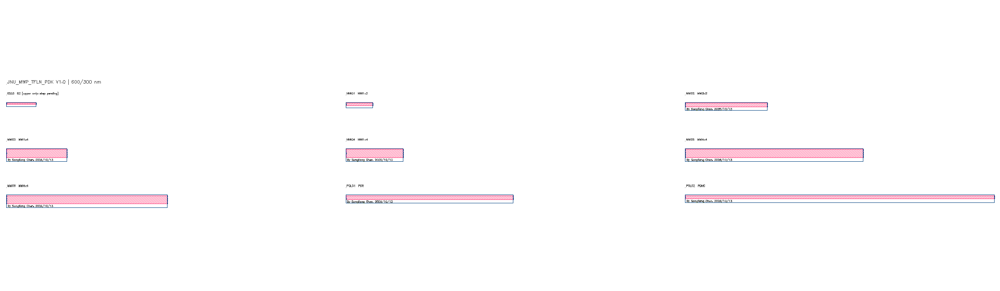

  
  

# JNU_MWP_TFLN_PDK

暨南大学光电混合集成实验室的 KLayout 薄膜铌酸锂（TFLN）PDK。V1.0 提供 `JNU_MWP_TFLN_PDK` Technology、四组工艺器件库、12 个固定黑盒、47 个光学端口、9 个公开 PCell 及版图功能菜单。

公开版可独立安装和放置黑盒器件。黑盒保留矩形占位、PinRec、DevRec、器件标签和作者署名；白盒 GDS、FSP 及内部器件轮廓由独立授权提供，不随公开仓库发布。黑盒用于布局和端口连接，最终制造需使用获授权的白盒轮廓。

## 安装与更新

### Windows：拖入 KLayout 安装

首次安装需要 KLayout 0.30.x、Python 宏支持及 [Git](https://git-scm.com/downloads)。

1. **[下载安装宏 Install_JNU_TFLN_PDK.lym](https://github.com/Jerry-behappy/JNU_MWP_TFLN_PDK/releases/download/installer-macro/Install_JNU_TFLN_PDK.lym)**。
2. 将 `.lym` 拖入平时使用的 KLayout，在 **Macro Development** 中选择 **Install JNU TFLN PDK**，点击绿色 **Run**，再点击“安装 / 更新”。
3. 完成后重启 KLayout，选择 `JNU_MWP_TFLN_PDK` Technology，确认五个 Library 和 `JNU_MWP_TFLN_PDK V1.0` 顶部菜单出现。

安装宏自动从正在运行的 KLayout 读取用户配置目录，后台克隆 main 并建立目录联接，无需手动填写路径，也不要求程序与源码位于同一盘。已克隆的公开版可重新运行同一个宏进行安全更新。也可使用下方 AI 提示词安装。

### 用 AI 代理安装或更新

将以下文字复制给能够访问本机文件并执行命令的 AI 代理。

**安装提示词**

> 请在我平时使用的 KLayout 中安装 https://github.com/Jerry-behappy/JNU_MWP_TFLN_PDK 。优先使用 Install_JNU_TFLN_PDK.lym，自动读取当前 KLayout 用户目录，通过 Git 克隆和目录联接安装。保留其他 PDK、现有 TFLN 安装、白盒和本地修改。完成后重启并检查 Technology、五个 Library、12 个黑盒、9 个 PCell 和功能菜单。

**更新提示词**

> 请更新我当前 KLayout 安装的 JNU_MWP_TFLN_PDK。找到实际使用的 Git 克隆，只在工作树干净且可快进时更新当前分支，保留本地修改及授权白盒。更新后检查器件库和菜单，并说明是否需要重启 KLayout。

### 更新与白盒

- 重新运行安装宏，点击“安装 / 更新”，检查远端并只对干净 main 做快进更新。也可在克隆目录执行 `git pull --ff-only origin main`；完成后重启 KLayout。仅修改 Python 功能时可运行菜单中的 **重新加载 TFLN PDK**。
- 白盒与原始仿真工程单独保存和授权；菜单可导入已获授权的本地 GDS；白盒保存在独立私有目录，公开仓库不提供白盒下载。
- 贡献者通过功能分支与 PR 提交更新；`main` 禁止直接推送、强推和删除。

## 器件库

| Library | 薄膜厚度 / 刻蚀深度（nm） | 器件 | 数量 |
|---|---:|---|---:|
| `JNULib_TFLN_300_125` | 300 / 125 | EC01 | 1 |
| `JNULib_TFLN_400_200` | 400 / 200 | EC02 | 1 |
| `JNULib_TFLN_600_300` | 600 / 300 | EC03、MMI01–06、POL01–02 | 9 |
| `JNULib_TFLN_600_600` | 600 / 600 | EC04 | 1 |
| `JNULib_TFLN_pcell` | 参数化 / Parametric | SOI 公开 PCell / Public SOI PCells | 9 |

完整参数、端口和文件索引见 [器件清单](docs/DEVICE_INDEX.md)。EC01–EC03 的低台阶仍待处理；未知参数使用 `Unknow`，参数差异保留在公开清单中。

菜单覆盖 JNU PDK 的波导与版图工具、DRC、更新和授权库导入，共 26 项，中英文同时显示。PCell 保留 SOI 默认尺寸与几何算法，需按 TFLN 工艺验证光学性能。库列表不再显示作者，GDS 框内署名保留。

## 功能与使用说明

点击功能框进入[详细使用说明](docs/USER_GUIDE.md)。菜单名称使用中英文并列，数据库单位为 **0.0001 µm**。

<table>
  <tr><th colspan="2">JNU_MWP_TFLN_PDK V1.0 · 功能框图</th></tr>
  <tr>
    <td width="50%"></td>
    <td width="50%"></td>
  </tr>
  <tr>
    <td width="50%"></td>
    <td width="50%"></td>
  </tr>
  <tr>
    <td width="50%"></td>
    <td width="50%"></td>
  </tr>
</table>

器件内原生文字署名：**By Songliang Chen, 2026/10/13**。

[更新说明](../../CHANGELOG.md) · [问题反馈](https://github.com/Jerry-behappy/JNU_MWP_TFLN_PDK/issues) · [许可证](../../LICENSE.md) · [相关 SOI PDK](https://github.com/Jerry-behappy/JNU-MWP-SOI-PDK)
